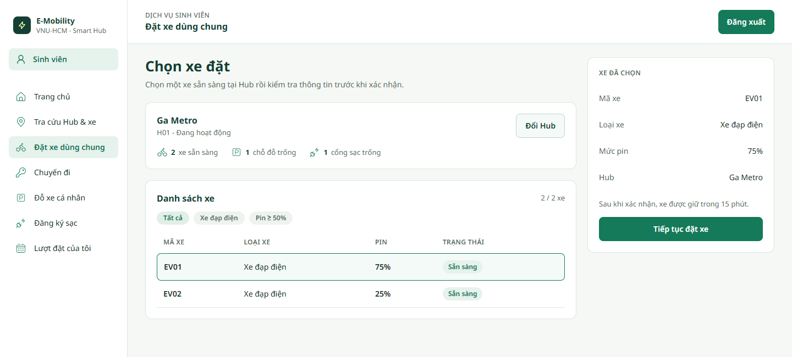
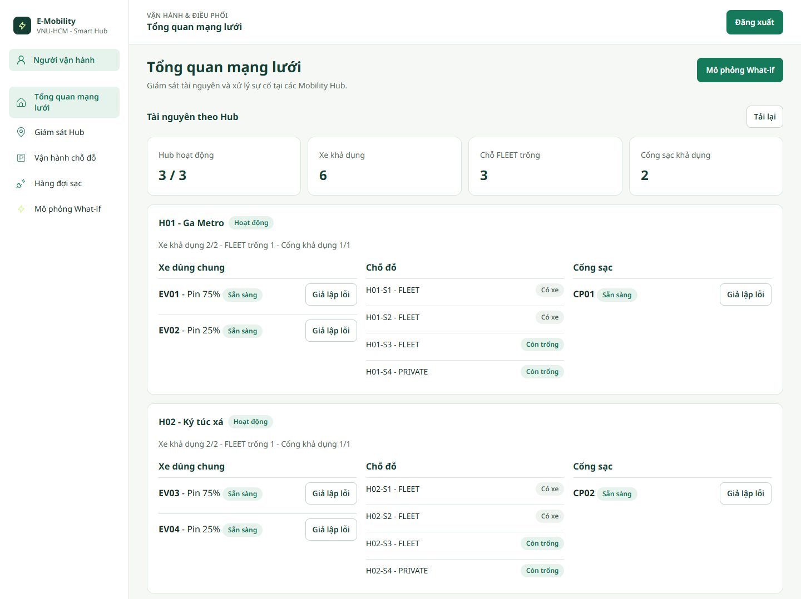
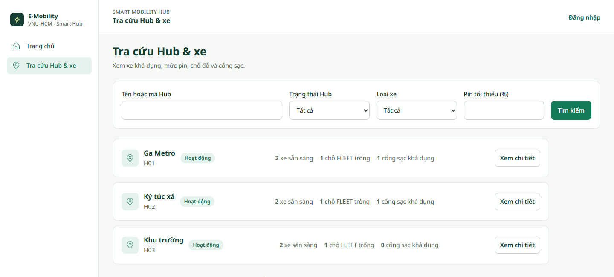

# Smart E-Mobility Hub

Bài tập lớn môn **Software Engineering (CO3001)**, Trường Đại học Bách khoa - ĐHQG TP.HCM (**HCMUT**), học kỳ 261, nhóm L02_1.

Ứng dụng quản lý Mobility Hub dành cho sinh viên và người vận hành. [Mở bản demo trên Vercel](https://smart-emobility-hub.vercel.app).

| Vai trò | Luồng chính |
|---|---|
| Khách | Tra cứu Hub, xe, pin, chỗ đỗ và cổng sạc |
| Student | Đặt/hủy, nhận và trả xe dùng chung, đặt chỗ đỗ cá nhân, đăng ký sạc |
| Operator | Theo dõi mạng lưới, xử lý chỗ đỗ và hàng đợi sạc, giả lập sự cố, chạy What-if |

## Giao diện demo

Ảnh chụp giao diện mới khi chạy trên localhost.

### Sinh viên chọn xe dùng chung



### Operator theo dõi tài nguyên



### Tra cứu Mobility Hub



## Chạy trên máy

Dùng Node.js 24 và npm.

```sh
git clone https://github.com/taitrn/smart-emobility-hub.git
cd smart-emobility-hub
npm ci
```

Tạo `.env.local` từ `.env.example`, điền URL và publishable key của Supabase demo rồi chạy `npm run dev`. Mở <http://localhost:3000>. Trang chủ và health chạy khi thiếu env. Dữ liệu Hub và các trang cần đăng nhập dùng Supabase. Nhận tài khoản demo riêng từ nhóm và giữ `.env.local` trên máy. [Hướng dẫn cài đặt](docs/SETUP.md)

## Kiểm tra và demo

```sh
npm run lint
npm run typecheck
npm test
npm run build
```

[npm run smoke](docs/SETUP.md#kiểm-tra-local) kiểm tra API local khi chưa đăng nhập. [Demo và kiểm thử](docs/implementation/04_UI_AND_DEMO.md) ghi dữ liệu mẫu, luồng đã kiểm tra và giới hạn. Thiết bị nhận/trả xe, sạc và sự cố được mô phỏng trong ứng dụng. What-if đọc snapshot và chỉ đưa ra khuyến nghị.

## Cấu trúc

| Thư mục | Nội dung |
|---|---|
| `src/app` | Trang Next.js và API |
| `src/components` | Layout và component dùng chung |
| `src/features` | Nghiệp vụ theo chức năng |
| `src/lib`, `src/config` | Auth, HTTP, types và cấu hình dùng chung |
| `supabase` | Migration, dữ liệu mẫu và test SQL |
| `tests`, `scripts` | Test Node và smoke API |
| `docs` | Cài đặt, kiến trúc, hợp đồng API và demo |

- [Kiến trúc](docs/ARCHITECTURE.md) và [hợp đồng dữ liệu](docs/DATA_CONTRACT.md).
- [Cấu hình Supabase](docs/AUTH_SETUP.md) dành cho quản trị project.
- [Quy trình đóng góp](docs/CONTRIBUTING.md) và [phạm vi MVP](docs/implementation/README.md).
